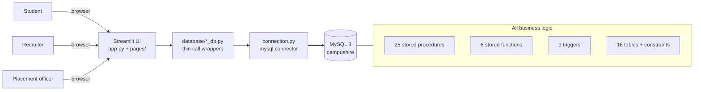
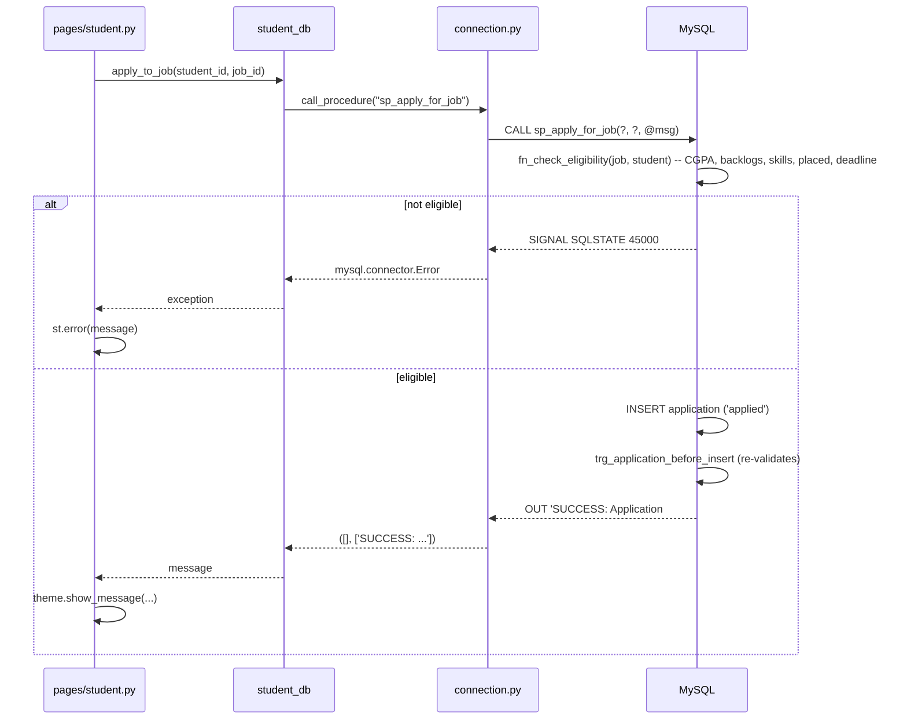

# CampusHire — Architecture

System architecture for the College Placement Portal: layered structure, component
responsibilities, request lifecycle and the constraints that shape the design.

> Companion documents: [`workflow.md`](workflow.md) · [`er_diagram.md`](er_diagram.md) · [`files.md`](files.md)

---

## 1. Goals and constraints

| Goal | How it is met |
| --- | --- |
| Demonstrate DBMS concepts, not Python logic | 100% of rules live in SQL procedures, functions and triggers |
| Course syllabus only | DDL, DML, DQL, joins, subqueries, `ANY`/`ALL`, `EXISTS`, `UNION`/`INTERSECT`/`EXCEPT`, procedures, functions, triggers |
| No views | Every multi-table read is a stored procedure built from JOINs + subqueries + `GROUP BY` |
| Referential correctness | Foreign keys with explicit `ON DELETE` behaviour + `CHECK` constraints |
| Auditable workflow | `audit_log` rows written by triggers, never by Python |
| Credentials out of source | Secrets → env vars → defaults resolution in `connection.py` |

Deliberately **out of scope**: REST/HTTP API, ORM, background workers, caching service,
SQL views, window functions in application paths.

---

## 2. System context



---

## 3. Layers

| Layer | Files | Responsibility | Must not |
| --- | --- | --- | --- |
| Presentation | `app.py`, `pages/student.py`, `pages/recruiter.py`, `pages/officer.py`, `theme.py` | Widgets, navigation, formatting, colour | Contain workflow rules |
| Service / query adapter | `database/auth_db.py`, `student_db.py`, `recruiter_db.py`, `application_db.py`, `officer_db.py`, `placement_db.py` | One function per feature; binds parameters; forwards to SQL | Build business logic or aggregate in Pandas |
| Transport | `database/connection.py` | Connection caching, cursor handling, `call_procedure`, OUT params | Know any domain rule |
| Data / rules | `mysql/*.sql` | Schema, constraints, functions, procedures, triggers | Depend on Python |
| Tooling | `init_db.py`, `requirements.txt`, `start_dashboard.bat` | Bootstrap and convenience | Run at application runtime |

### 3.1 Why the Python layer is thin

`connection.call_procedure()` is the only doorway to the database for anything that changes
state. It returns `(rows, outs)`; the last OUT parameter is a message string. This keeps the
UI honest: it can only report what MySQL decided.

---

## 4. Directory structure

```text
Placement_Portal_DBMS/
├── app.py                  # login + role routing (st.switch_page)
├── init_db.py              # applies mysql/*.sql in dependency order
├── theme.py                # shared CSS, metric cards, message rendering
├── streamlit_dashboard.py  # standalone demo (dummy data, no DB) — not part of app
├── start_dashboard.bat     # convenience launcher
├── requirements.txt
├── workflow.md  architecture.md  er_diagram.md  files.md
├── .streamlit/             # optional secrets.toml / config
├── database/
│   ├── connection.py       # connection factory + call_procedure
│   ├── auth_db.py          # login, id lookups
│   ├── student_db.py       # student features
│   ├── recruiter_db.py     # recruiter features
│   ├── application_db.py   # officer application review
│   ├── officer_db.py       # officer monitoring
│   └── placement_db.py     # analytics + reports
├── pages/
│   ├── student.py
│   ├── recruiter.py
│   └── officer.py
└── mysql/
    ├── schema.sql          # DDL: 16 tables
    ├── functions.sql       # 6 functions
    ├── procedures.sql      # 25 procedures
    ├── triggers.sql        # 9 triggers
    ├── sample_data.sql     # demo dataset
    └── advanced_queries.sql# syllabus query reference (manual)
```

---

## 5. Component responsibilities inside MySQL

| Group | Objects | Purpose |
| --- | --- | --- |
| Identity | `sp_verify_login`, `sp_register_student`, `app_user` | Credential check with `SHA2(...,256)` done in SQL |
| Student profile | `sp_update_student_profile`, `sp_add_student_skill`, `sp_list_student_profiles` | Profile maintenance and read model |
| Job market | `sp_post_job`, `sp_close_job`, `sp_list_job_details`, `sp_list_open_jobs` | Posting lifecycle and browsing with eligibility |
| Selection | `sp_apply_for_job`, `sp_withdraw_application`, `sp_shortlist_applicant`, `sp_reject_applicant`, `sp_list_applications` | Funnel transitions |
| Interviews | `sp_schedule_interview`, `sp_update_interview_result`, `trg_interview_before_insert` | Round scheduling and outcome |
| Offers | `sp_make_offer`, `sp_auto_offer_selected`, `sp_respond_to_offer`, `trg_offer_*` | Release, accept, decline |
| Placement | `trg_placement_after_insert`, `placement` | Automatic placement record and job closure |
| Analytics | `sp_get_placement_stats`, `sp_branch_placement_analytics`, `sp_company_hiring_stats`, `sp_generate_branch_report`, `sp_get_student_dashboard` | Dashboards and reports |
| Audit | `audit_log`, `trg_application_after_update`, `trg_offer_after_*`, `trg_placement_after_insert` | Change history |

---

## 6. Request lifecycle

### 6.1 Sign-in

```mermaid
sequenceDiagram
    participant UI as app.py
    participant A as auth_db
    participant C as connection.py
    participant M as MySQL

    UI->>A: verify_login(email, password)
    A->>C: call_procedure("sp_verify_login", out_count=4)
    C->>M: CALL sp_verify_login(?, ?, @u, @r, @n, @m)
    M->>M: SELECT ... WHERE password_hash = SHA2(password, 256)
    M-->>C: OUT user_id, role, full_name, message
    C-->>A: ([], [user_id, role, full_name, msg])
    A-->>UI: dict or None
    UI->>UI: st.session_state["user"] = {...}; st.switch_page(...)
```

### 6.2 Apply for a job (write path)



### 6.3 Accept an offer (trigger chain)

```text
sp_respond_to_offer → UPDATE offer.status='accepted'
                    → trg_offer_before_update (pending only)
                    → trg_offer_after_update  → INSERT placement
                    → trg_placement_after_insert → application='placed', job closed when full, audit row
```

---

## 7. State ownership

| Concern | Owner | Rationale |
| --- | --- | --- |
| Password hashing | MySQL `SHA2()` inside `sp_verify_login` / `sp_register_student` | Keeps the rule next to the data |
| Eligibility | `fn_check_eligibility` + trigger | Single definition reused by browse, apply and insert |
| Skill match % | `fn_student_skill_match` | Deterministic computation over two junction tables |
| Placement status text | `fn_student_status` | Consistent label for every dashboard |
| Workflow transitions | Procedures (with `SIGNAL`) | One code path per transition |
| Placement creation | Trigger only | Impossible to create an orphan placement |
| Aggregations | Procedures / SQL `GROUP BY` | Pandas only formats, never computes |
| Presentation | Streamlit | Purely visual |

---

## 8. Configuration and security

- Connection settings resolved per call in `database/connection.py`:
  `.streamlit/secrets.toml` → environment variables → local defaults.
- The password hash column is `CHAR(64)` (SHA-256 hex) filled by `SHA2(pwd, 256)`; plain
  passwords never touch a table.
- `init_db.py` attempts `SET GLOBAL log_bin_trust_function_creators = 1` and ignores the
  error when the account lacks the privilege (only needed for function creation with binary
  logging enabled).
- `streamlit_dashboard.py` contains **no** credentials and no database code — it is a
  data-visualisation demo only.

---

## 9. Version requirements

| Feature used | Minimum MySQL |
| --- | --- |
| `CHECK` constraints enforced | 8.0.16 |
| `JSON_TABLE` in `sp_post_job` (skill list parsing) | 8.0.19 |
| `INTERSECT` / `EXCEPT` in `advanced_queries.sql` | 8.0.31 |

If your server is below 8.0.19, pass skills one per job by editing `sp_post_job`; the rest
of the application is unaffected.

---

## 10. Extension points

| Need | Where to add | Constraint |
| --- | --- | --- |
| New workflow state | `application.status` ENUM + a procedure + `workflow.md` diagram | Keep the state machine acyclic |
| New report | One procedure returning a single result set | No views |
| REST API | A new adapter that calls the same `sp_*` procedures | Do not move rules to Python |
| More demo data | `mysql/sample_data.sql` | Must satisfy triggers |
| Auth for a new role | `app_user.role` ENUM + a page + id lookup in `auth_db` | Reuse `sp_verify_login` |
