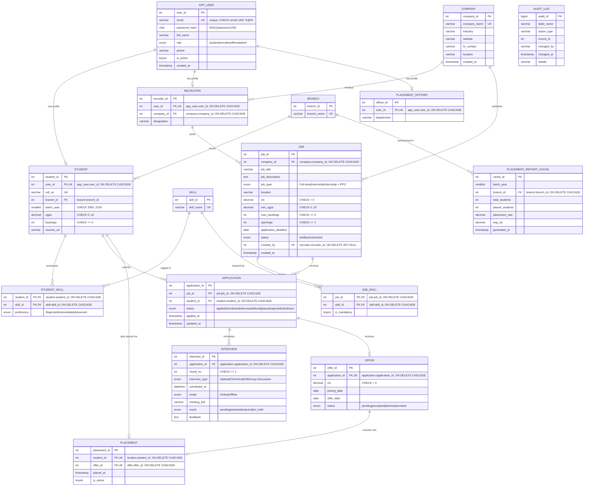

# CampusHire — Entity Relationship Diagram

Conceptual and physical data model of the `campushire` schema (`mysql/schema.sql`).
16 tables, 18 foreign keys, no views.

> Companion documents: [`architecture.md`](architecture.md) · [`workflow.md`](workflow.md) · [`files.md`](files.md)

---

## 1. ER diagram



---

## 2. Entity dictionary

| # | Table | Type | Rows in demo seed | Purpose |
| --- | --- | --- | --- | --- |
| 1 | `app_user` | Supertype | 27 | One account per person; `role` decides the dashboard |
| 2 | `branch` | Master | 5 | CSE, IT, ECE, Mechanical, Civil |
| 3 | `student` | Subtype of `app_user` | 20 | Academic profile used for eligibility |
| 4 | `recruiter` | Subtype of `app_user` | 5 | Ties a hiring account to a company |
| 5 | `placement_officer` | Subtype of `app_user` | 2 | Training & Placement Cell staff |
| 6 | `skill` | Master | 18 | Skill vocabulary |
| 7 | `student_skill` | Junction | 75 | M:N student ↔ skill with proficiency |
| 8 | `company` | Master | 5 | Recruiting organisation |
| 9 | `job` | Transaction | 6 | Posting with eligibility thresholds |
| 10 | `job_skill` | Junction | 19 | M:N job ↔ skill with mandatory flag |
| 11 | `application` | Transaction | 22 | One student applying to one job |
| 12 | `interview` | Transaction | 10 | Rounds per application |
| 13 | `offer` | Transaction | 7 | At most one per application |
| 14 | `placement` | Transaction | 6 | At most one per student, created by trigger |
| 15 | `audit_log` | Support | grows | Append-only change history |
| 16 | `placement_report_cache` | Support | on demand | Output of `sp_generate_branch_report` |

### 2.1 User specialisation strategy

`app_user` holds shared attributes (`email`, `password_hash`, `full_name`, `role`, `phone`).
Each role has a separate profile table with a **1:1** relationship enforced by
`UNIQUE (user_id)`; `ON DELETE CASCADE` removes the profile with the account.

---

## 3. Relationship matrix

| Parent | Child | Cardinality | FK column | On delete |
| --- | --- | --- | --- | --- |
| `app_user` | `student` | 1 : 0..1 | `student.user_id` | CASCADE |
| `app_user` | `recruiter` | 1 : 0..1 | `recruiter.user_id` | CASCADE |
| `app_user` | `placement_officer` | 1 : 0..1 | `placement_officer.user_id` | CASCADE |
| `branch` | `student` | 1 : 0..N | `student.branch_id` | RESTRICT |
| `branch` | `placement_report_cache` | 1 : 0..N | `cache.branch_id` | CASCADE |
| `company` | `recruiter` | 1 : 0..N | `recruiter.company_id` | CASCADE |
| `company` | `job` | 1 : 0..N | `job.company_id` | CASCADE |
| `recruiter` | `job` | 1 : 0..N | `job.created_by` | SET NULL |
| `student` | `student_skill` | 1 : 0..N | `student_skill.student_id` | CASCADE |
| `skill` | `student_skill` | 1 : 0..N | `student_skill.skill_id` | CASCADE |
| `job` | `job_skill` | 1 : 0..N | `job_skill.job_id` | CASCADE |
| `skill` | `job_skill` | 1 : 0..N | `job_skill.skill_id` | CASCADE |
| `student` | `application` | 1 : 0..N | `application.student_id` | CASCADE |
| `job` | `application` | 1 : 0..N | `application.job_id` | CASCADE |
| `application` | `interview` | 1 : 0..N | `interview.application_id` | CASCADE |
| `application` | `offer` | 1 : 0..1 | `offer.application_id` | CASCADE |
| `student` | `placement` | 1 : 0..1 | `placement.student_id` | CASCADE |
| `offer` | `placement` | 1 : 0..1 | `placement.offer_id` | CASCADE |

`audit_log` intentionally has no foreign keys so deletions can still be recorded.

---

## 4. Constraint summary

### 4.1 Entity integrity (primary keys)

Every table has a surrogate integer primary key (with named `pk_*` constraints); the two
junction tables use composite primary keys: `student_skill(student_id, skill_id)` and
`job_skill(job_id, skill_id)`.

### 4.2 Candidate keys (UNIQUE)

| Constraint | Table | Columns | Business meaning |
| --- | --- | --- | --- |
| `uq_app_user_email` | `app_user` | `email` | One account per email |
| `uq_student_user` | `student` | `user_id` | One student profile per account |
| `uq_student_roll` | `student` | `roll_no` | Unique university roll number |
| `uq_recruiter_user` | `recruiter` | `user_id` | One recruiter profile per account |
| `uq_officer_user` | `placement_officer` | `user_id` | One officer profile per account |
| `uq_branch_name` | `branch` | `branch_name` | No duplicate departments |
| `uq_company_name` | `company` | `company_name` | No duplicate employers |
| `uq_skill_name` | `skill` | `skill_name` | Controlled skill vocabulary |
| `uq_application_job_student` | `application` | `(job_id, student_id)` | One application per job per student |
| `uq_interview_round` | `interview` | `(application_id, round_no)` | One row per round |
| `uq_offer_application` | `offer` | `application_id` | One offer per application |
| `uq_placement_student` | `placement` | `student_id` | A student is placed once |
| `uq_placement_offer` | `placement` | `offer_id` | An offer yields one placement |
| `uq_report_cache` | `placement_report_cache` | `(batch_year, branch_id)` | One cached row per branch per batch |

### 4.3 Domain integrity (CHECK)

`cgpa BETWEEN 0 AND 10` · `backlogs >= 0` · `batch_year BETWEEN 2000 AND 2100` ·
`ctc > 0` (job and offer) · `min_cgpa BETWEEN 0 AND 10` · `max_backlogs >= 0` ·
`openings >= 1` · `round_no >= 1` · `email LIKE '%@%'`.

### 4.4 Referential integrity actions

| Action | Used by | Reason |
| --- | --- | --- |
| `ON DELETE CASCADE` | profile, skill, job, application, interview, offer, placement edges | Removing a parent removes its dependants cleanly |
| `ON DELETE SET NULL` | `job.created_by → recruiter` | A posting survives its author's removal |

Deleting a `job` therefore cascades to its `application` rows and from there to
`interview`, `offer` and `placement` — the behaviour the officer "Delete job" action relies on.

---

## 5. Workflow invariants encoded in the model

| Invariant | Enforced by |
| --- | --- |
| Cannot apply twice to the same job | `uq_application_job_student` |
| Cannot be placed twice | `uq_placement_student` |
| Cannot have two offers for one application | `uq_offer_application` |
| Interviews only after shortlisting | `trg_interview_before_insert` |
| Offers only after a selected interview | `trg_offer_before_insert` |
| Placement appears only when an offer is accepted | `trg_offer_after_update` |
| A placed student cannot apply again | `trg_application_before_insert` + `fn_check_eligibility` |

---

## 6. Reporting model

Two tables exist purely for reporting and are never read by the UI as raw data:

- `audit_log` — append-only, written by `trg_application_after_update`,
  `trg_offer_after_insert`, `trg_offer_after_update`, `trg_placement_after_insert`.
- `placement_report_cache` — written by `sp_generate_branch_report`, which cursor-loops
  over `branch` and stores one aggregate row per branch for a batch year. The procedure
  then returns the joined, ordered result set.

---

## 7. Verifying the model against a live server

```sql
USE campushire;

-- tables and their engines
SELECT table_name, engine FROM information_schema.tables
 WHERE table_schema = 'campushire' ORDER BY table_name;

-- every foreign key
SELECT table_name, constraint_name, referenced_table_name,
       delete_rule, update_rule
  FROM information_schema.referential_constraints
 WHERE constraint_schema = 'campushire';

-- keys per table
SELECT table_name, constraint_name, constraint_type
  FROM information_schema.table_constraints
 WHERE table_schema = 'campushire' AND constraint_type IN ('PRIMARY KEY','UNIQUE','CHECK')
 ORDER BY table_name, constraint_type;
```

The diagram above can be regenerated by reading `mysql/schema.sql`; the Mermaid block
renders on GitHub, GitLab and most Markdown viewers.
