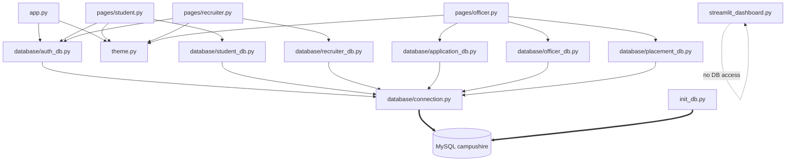

# CampusHire — File Guide, Call Flow and Feature Map

Every file in the project, what it imports, who calls it, and which SQL object implements
each feature.

> Companion documents: [`architecture.md`](architecture.md) · [`workflow.md`](workflow.md) · [`er_diagram.md`](er_diagram.md)

---

## 1. File tree

```text
Placement_Portal_DBMS/
├── app.py                     login screen + role routing
├── init_db.py                 bootstrap: applies mysql/*.sql in order
├── theme.py                   shared CSS + UI helpers
├── streamlit_dashboard.py     standalone demo dashboard (dummy data, no MySQL)
├── start_dashboard.bat        convenience launcher
├── requirements.txt           streamlit, mysql-connector-python, pandas, plotly
├── workflow.md  architecture.md  er_diagram.md  files.md
├── .streamlit/                optional secrets.toml
├── database/
│   ├── connection.py          MySQL connection + call_procedure
│   ├── auth_db.py             login, profile id lookups
│   ├── student_db.py          student features
│   ├── recruiter_db.py        recruiter features
│   ├── application_db.py      officer: application review
│   ├── officer_db.py          officer: monitoring
│   └── placement_db.py        officer: analytics + reports
├── pages/
│   ├── student.py             student dashboard
│   ├── recruiter.py           recruiter dashboard
│   └── officer.py             placement officer dashboard
└── mysql/
    ├── schema.sql             DDL — 16 tables
    ├── functions.sql          6 functions
    ├── procedures.sql         25 procedures
    ├── triggers.sql           9 triggers
    ├── sample_data.sql        demo rows
    └── advanced_queries.sql   syllabus query reference (manual, read-only)
```

---

## 2. Import / call graph (Python)



Rules visible in the graph:

- `connection.py` is the **only** module that imports `mysql.connector`.
- `theme.py` imports only `streamlit` and `plotly`; it never touches the database.
- `pages/*.py` never import each other; navigation goes through `st.switch_page`.
- `streamlit_dashboard.py` sits outside the application graph — it renders dummy data only.

---

## 3. File-by-file reference

### 3.1 Root

| File | Purpose | Imports | Called by | Key definitions |
| --- | --- | --- | --- | --- |
| `app.py` | Entry point. Renders login form, verifies credentials, stores the session user, routes to the role page. Shows MySQL version badge. | `streamlit`, `database.auth_db`, `database.connection`, `theme` | Streamlit runtime; every page redirects here on sign-out | `PAGES` dict, login form, `st.switch_page` routing |
| `init_db.py` | One-shot bootstrap. Splits each `.sql` file on `DELIMITER`, executes statement by statement, prints row counts. | `os`, `pathlib`, `mysql.connector` | developer (`python init_db.py`) | `FILES`, `split_sql_script()`, `run_file()`, `main()` |
| `theme.py` | Shared visual layer: dark navy CSS, status pills, metric cards, page headers, Plotly theming, SUCCESS/ERROR rendering, sign-out. | `streamlit`, `plotly.graph_objects` | all three pages + `app.py` | `inject_css()`, `metric_card()`, `page_header()`, `style_figure()`, `show_message()`, `pill()`, `sign_out_button()`, `STATUS_COLORS` |
| `streamlit_dashboard.py` | Standalone analytics demo with hard-coded dummy data (design reference). **Not** imported by the app and never opens a database connection. | `streamlit`, `plotly`, `pandas` | `streamlit run streamlit_dashboard.py` | `get_dummy_*()` helpers, section renderers |
| `start_dashboard.bat` | Windows convenience launcher for Streamlit. | — | user | — |

### 3.2 `database/`

| File | Purpose | Imports | Called by | Key definitions |
| --- | --- | --- | --- | --- |
| `connection.py` | Single connection factory with `st.cache_resource`, credentials resolution (secrets → env → defaults), `fetch_all`, `fetch_one`, `execute`, `call_procedure`, `message_of`, `server_info`. | `os`, `warnings`, `mysql.connector`, `streamlit` | every `*_db.py` | `_config()`, `get_connection()`, `fetch_all()`, `fetch_one()`, `execute()`, `call_procedure()`, `message_of()`, `server_info()` |
| `auth_db.py` | Credential check and role-id lookups. | `connection` | `app.py`, both dashboards | `verify_login()`, `get_student_id()`, `get_recruiter_id()`, `get_officer_id()` |
| `student_db.py` | All student reads and writes. | `connection` | `pages/student.py` | `get_profile`, `get_dashboard`, `update_profile`, `list_branches`, `list_jobs`, `get_job`, `get_job_skills`, `apply_to_job`, `withdraw_application`, `get_applications`, `get_interviews`, `get_offers`, `respond_to_offer`, `get_skills`, `list_skill_catalog`, `add_skill`, `remove_skill` |
| `recruiter_db.py` | Recruiter reads and every workflow transition. | `connection` | `pages/recruiter.py` | `get_recruiter`, `update_company`, `get_jobs`, `post_job`, `close_job`, `get_applicants`, `shortlist`, `reject`, `schedule_interview`, `get_interviews`, `update_interview_result`, `make_offer`, `auto_offer_selected`, `get_offers`, `get_metrics`, `get_status_funnel`, `get_applications_per_job` |
| `application_db.py` | Officer-side application review and override. | `connection` | `pages/officer.py` | `VALID_STATUSES`, `get_applications`, `get_application`, `get_interviews`, `get_history`, `update_status`, `get_status_counts` |
| `officer_db.py` | Officer monitoring, cleanup and audit. | `connection` | `pages/officer.py` | `get_students`, `get_companies`, `get_jobs`, `get_applications`, `get_offers`, `delete_job`, `get_audit_log`, `get_unplaced_students`, `get_pending_offers`, `get_branch_names` |
| `placement_db.py` | Analytics, placements and reports. | `connection` | `pages/officer.py` | `get_placements`, `get_metrics`, `get_department_stats`, `get_company_stats`, `get_monthly_stats`, `get_branch_report`, `get_batches` |

### 3.3 `pages/`

| File | Guard | Sidebar menu | Data modules |
| --- | --- | --- | --- |
| `pages/student.py` | `role == "student"` | Overview · Browse Jobs · My Applications · Interviews & Offers · Profile & Skills | `auth_db`, `student_db` |
| `pages/recruiter.py` | `role == "recruiter"` | Overview · Post Job · My Jobs · Applicants · Interviews · Offers · Company Profile | `auth_db`, `recruiter_db` |
| `pages/officer.py` | `role in ("officer", "admin")` | Overview · Students · Companies · Jobs · Applications · Placements · Reports · Audit Log | `application_db`, `officer_db`, `placement_db` |

Each page starts with `st.set_page_config(...)` + `inject_css()`, then blocks unauthorised
visitors with `st.warning` + `st.stop()`.

### 3.4 `mysql/`

| File | Contents | Executed by | Depends on |
| --- | --- | --- | --- |
| `schema.sql` | `DROP DATABASE` / `CREATE DATABASE`, 16 `CREATE TABLE` (PK, FK, UNIQUE, CHECK), indexes | `init_db.py` step 1 | — |
| `functions.sql` | `fn_check_eligibility`, `fn_student_skill_match`, `fn_company_avg_ctc`, `fn_branch_placement_rate`, `fn_student_status`, `fn_round_passed` | step 2 | tables |
| `procedures.sql` | 25 procedures (identity, profile, jobs, selection, interviews, offers, reports, read models) | step 3 | functions |
| `triggers.sql` | 9 triggers (job, application, interview, offer, placement) | step 4 | tables + functions |
| `sample_data.sql` | 27 users, 20 students, 5 companies, 5 recruiters, 6 jobs, 22 applications, 10 interviews, 7 offers → 6 placements | step 5 | all objects |
| `advanced_queries.sql` | Syllabus demonstrations: `WHERE`/`ORDER BY`, scalar functions, aggregates, `GROUP BY`/`HAVING`, subqueries, `ANY`/`ALL`, `EXISTS`/`NOT EXISTS`, `UNION`/`INTERSECT`/`EXCEPT`, correlated ranking | manual only | seeded data |

---

## 4. Feature → file → function → SQL object

### 4.1 Authentication and routing

| Feature | UI | Python function | SQL object |
| --- | --- | --- | --- |
| Sign in | `app.py` login form | `auth_db.verify_login` | `sp_verify_login` (`SHA2` compare) |
| Log out | `theme.sign_out_button` | pops `st.session_state["user"]` | — |
| Resolve student id | `pages/student.py` banner | `auth_db.get_student_id` | `SELECT student_id` |
| Resolve recruiter id | `pages/recruiter.py` banner | `auth_db.get_recruiter_id` | `SELECT recruiter_id` |
| Resolve officer id | `pages/officer.py` banner | `auth_db.get_officer_id` | `SELECT officer_id` |
| DB health badge | `app.py` sidebar | `connection.server_info` | `SELECT VERSION(), DATABASE()` |

### 4.2 Student features

| Feature | UI section | Python function | SQL object |
| --- | --- | --- | --- |
| Profile card | sidebar | `student_db.get_profile` | `sp_list_student_profiles` |
| Dashboard KPIs | Overview | `student_db.get_dashboard` | `sp_get_student_dashboard` + `fn_student_status` |
| Browse open jobs | Browse Jobs / Overview | `student_db.list_jobs` | `sp_list_open_jobs` + `fn_check_eligibility` + `fn_student_skill_match` |
| Job detail + skills | Browse Jobs | `student_db.get_job`, `student_db.get_job_skills` | `sp_list_job_details`, join on `job_skill` |
| "Already applied?" check | Browse Jobs | `student_db.get_applications` | `sp_list_applications` |
| Apply to job | Browse Jobs → Apply | `student_db.apply_to_job` | `sp_apply_for_job` → `trg_application_before_insert` |
| Withdraw application | My Applications | `student_db.withdraw_application` | `sp_withdraw_application` |
| Application list | My Applications | `student_db.get_applications` | `sp_list_applications` |
| Interview rounds | My Applications / Interviews | `student_db.get_interviews` | join `interview`→`application`→`job`→`company` |
| Offers + respond | Interviews & Offers | `student_db.get_offers`, `student_db.respond_to_offer` | join query, `sp_respond_to_offer` → `trg_offer_after_update` → `trg_placement_after_insert` |
| Update profile | Profile & Skills | `student_db.update_profile` | `sp_update_student_profile` |
| Add / update skill | Profile & Skills | `student_db.add_skill` | `sp_add_student_skill` |
| Remove skill | Profile & Skills | `student_db.remove_skill` | `DELETE FROM student_skill` |
| Skill catalogue | Profile & Skills | `student_db.list_skill_catalog` | `SELECT skill` |

### 4.3 Recruiter features

| Feature | UI section | Python function | SQL object |
| --- | --- | --- | --- |
| Recruiter identity | sidebar | `recruiter_db.get_recruiter` | join `recruiter`→`app_user`→`company` |
| KPI cards | Overview | `recruiter_db.get_metrics` | scalar subqueries |
| Application funnel | Overview | `recruiter_db.get_status_funnel` | `GROUP BY application.status` |
| Applications per job | Overview | `recruiter_db.get_applications_per_job` | `LEFT JOIN` + `GROUP BY` |
| Post a job | Post Job | `recruiter_db.post_job` | `sp_post_job` (`JSON_TABLE` skill parsing) |
| Own job list | My Jobs / Applicants | `recruiter_db.get_jobs` | `sp_list_job_details` |
| Close a job | My Jobs | `recruiter_db.close_job` | `sp_close_job` |
| Applicant table | Applicants | `recruiter_db.get_applicants` | join + `fn_student_skill_match` |
| Shortlist | Applicants | `recruiter_db.shortlist` | `sp_shortlist_applicant` |
| Reject | Applicants | `recruiter_db.reject` | `sp_reject_applicant` |
| Schedule interview | Applicants | `recruiter_db.schedule_interview` | `sp_schedule_interview` → `trg_interview_before_insert` |
| Interview result | Applicants | `recruiter_db.update_interview_result` | `sp_update_interview_result` |
| Make offer | Applicants | `recruiter_db.make_offer` | `sp_make_offer` → `trg_offer_before_insert` |
| Bulk offers | My Jobs | `recruiter_db.auto_offer_selected` | `sp_auto_offer_selected` (CURSOR) |
| Interview schedule | Interviews | `recruiter_db.get_interviews` | join `interview`→`application`→`job` |
| Offer list | Offers | `recruiter_db.get_offers` | join `offer`→`application`→`job`→`student` |
| Company profile | Company Profile | `recruiter_db.update_company` | `sp_update_company` |

### 4.4 Placement officer features

| Feature | UI section | Python function | SQL object |
| --- | --- | --- | --- |
| KPI cards | Overview | `placement_db.get_metrics` | `sp_get_placement_stats` |
| Branch bar chart | Overview | `placement_db.get_department_stats` | `sp_branch_placement_analytics` |
| Monthly trend | Overview | `placement_db.get_monthly_stats` | `GROUP BY DATE_FORMAT(offer_date)` |
| Company chart | Overview | `placement_db.get_company_stats` | `sp_company_hiring_stats` |
| Student register | Students | `officer_db.get_students` | `sp_list_student_profiles` |
| Unplaced list | Students | `officer_db.get_unplaced_students` | `NOT EXISTS` on `placement` |
| Branch filter options | Students / Applications | `officer_db.get_branch_names` | `SELECT branch` |
| Company register | Companies | `officer_db.get_companies` | `sp_company_hiring_stats` |
| Job register | Jobs | `officer_db.get_jobs` | `sp_list_job_details` |
| Delete job | Jobs | `officer_db.delete_job` | `DELETE FROM job` (FK cascade) |
| Application review | Applications | `application_db.get_applications` | `sp_list_applications` |
| Status override | Applications | `application_db.update_status` | `UPDATE application` + `trg_application_after_update` |
| Placement table + CSV | Placements | `placement_db.get_placements` | join `placement`→`offer`→`job`→`company` |
| Branch report | Reports | `placement_db.get_branch_report` | `sp_generate_branch_report` (CURSOR → `placement_report_cache`) |
| Batch selector | sidebar | `placement_db.get_batches` | `SELECT DISTINCT batch_year` |
| Audit trail | Audit Log | `officer_db.get_audit_log` | `SELECT audit_log` |

---

## 5. Stored routine catalogue

### 5.1 Functions (`mysql/functions.sql`)

| Function | Returns | Used by |
| --- | --- | --- |
| `fn_check_eligibility(job_id, student_id)` | `TINYINT` | `sp_apply_for_job`, `trg_application_before_insert`, `sp_list_open_jobs`, `sp_get_student_dashboard` |
| `fn_student_skill_match(job_id, student_id)` | `DECIMAL(5,2)` % | `sp_list_applications`, `sp_list_open_jobs`, `recruiter_db.get_applicants` |
| `fn_company_avg_ctc(company_id)` | `DECIMAL(12,2)` | `advanced_queries.sql` |
| `fn_branch_placement_rate(branch_id, batch_year)` | `DECIMAL(5,2)` % | available for reports |
| `fn_student_status(student_id)` | `VARCHAR` | `sp_list_student_profiles`, `sp_get_student_dashboard` |
| `fn_round_passed(application_id)` | `TINYINT` | interview outcome checks |

### 5.2 Procedures (`mysql/procedures.sql`)

| Group | Procedures |
| --- | --- |
| Identity | `sp_verify_login`, `sp_register_student` |
| Student | `sp_update_student_profile`, `sp_add_student_skill`, `sp_get_student_dashboard` |
| Jobs | `sp_post_job`, `sp_close_job`, `sp_list_job_details`, `sp_list_open_jobs` |
| Selection | `sp_apply_for_job`, `sp_withdraw_application`, `sp_shortlist_applicant`, `sp_reject_applicant`, `sp_list_applications` |
| Interviews | `sp_schedule_interview`, `sp_update_interview_result` |
| Offers | `sp_make_offer`, `sp_auto_offer_selected`, `sp_respond_to_offer` |
| Company | `sp_update_company` |
| Read models | `sp_list_student_profiles`, `sp_branch_placement_analytics`, `sp_company_hiring_stats` |
| Reporting | `sp_get_placement_stats`, `sp_generate_branch_report` |

### 5.3 Triggers (`mysql/triggers.sql`)

| Trigger | Table / timing | Effect |
| --- | --- | --- |
| `trg_job_before_insert` | `job` BEFORE INSERT | rejects a past deadline |
| `trg_application_before_insert` | `application` BEFORE INSERT | `fn_check_eligibility` gate |
| `trg_application_after_update` | `application` AFTER UPDATE | writes status change to `audit_log` |
| `trg_interview_before_insert` | `interview` BEFORE INSERT | requires `shortlisted`/`interview` |
| `trg_offer_before_insert` | `offer` BEFORE INSERT | requires `interview` stage + a `selected` round + student not placed |
| `trg_offer_before_update` | `offer` BEFORE UPDATE | only `pending` offers may change status |
| `trg_offer_after_insert` | `offer` AFTER INSERT | audit row; placement if inserted as `accepted` |
| `trg_offer_after_update` | `offer` AFTER UPDATE | accept → placement; decline → application `rejected`; audit |
| `trg_placement_after_insert` | `placement` AFTER INSERT | application `placed`, job closed when full, audit |

---

## 6. Runtime flow summaries

### 6.1 Login to dashboard

```text
app.py  →  auth_db.verify_login(email, pwd)
        →  connection.call_procedure("sp_verify_login", out_count=4)
        →  st.session_state["user"] = {user_id, role, full_name, email}
        →  st.switch_page("pages/student.py" | recruiter.py | officer.py)
        →  page re-checks st.session_state["user"]["role"] before rendering
```

### 6.2 Student apply

```text
pages/student.py  →  student_db.apply_to_job
                  →  sp_apply_for_job → fn_check_eligibility
                  →  INSERT application → trg_application_before_insert
                  →  OUT "SUCCESS: Application #n submitted"
                  →  theme.show_message()  (green / red)
```

### 6.3 Recruiter to placement

```text
Pages/recruiter.py (applicants)
  → rdb.shortlist        → sp_shortlist_applicant
  → rdb.schedule_interview → sp_schedule_interview
  → rdb.update_interview_result → sp_update_interview_result
  → rdb.make_offer       → sp_make_offer
Pages/student.py
  → sdb.respond_to_offer → sp_respond_to_offer
                         → trg_offer_after_update → placement
                         → trg_placement_after_insert → application 'placed'
Pages/officer.py
  → pdb.get_placements / get_metrics / get_branch_report  (read the result)
```

### 6.4 Bootstrap

```text
init_db.py
  → schema.sql      (tables, constraints)
  → functions.sql   (6 functions)
  → procedures.sql  (25 procedures)
  → triggers.sql    (9 triggers)
  → sample_data.sql (fires triggers while seeding)
  → prints counts: users, jobs, applications, placements
```

---

## 7. Notes and gotchas

- **Single connector:** only `database/connection.py` imports `mysql.connector`; if you
  change the driver or pooling strategy, that is the only file to touch.
- **Result shape:** `call_procedure()` returns the *last non-empty* result set as
  `list[dict]`. OUT parameters are appended in declaration order; the final one is always
  the `SUCCESS:`/`ERROR:` message.
- **Cached connection:** `get_connection()` is wrapped in `st.cache_resource`, so it is
  shared per Streamlit session; `_healthy_connection()` reconnects when MySQL drops it.
- **Page guards:** pages are individual Streamlit scripts. Each one independently checks
  `st.session_state["user"]`, so deep-linking without signing in shows a warning instead of
  data.
- **`streamlit_dashboard.py`** is an independent design demo (dummy data, MySQL optional)
  and is not referenced by `app.py`, `pages/`, or `database/`.
- **`advanced_queries.sql`** is documentation: never executed by the app or by `init_db.py`.
- **No views anywhere:** every multi-table read is a procedure, so `information_schema.views`
  stays empty — the intended syllabus constraint.
