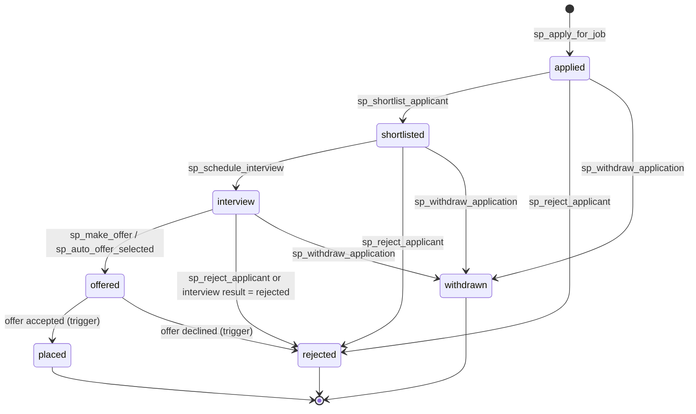

# CampusHire — Workflow

End-to-end operating workflow for the College Placement Portal: how the project is
installed, how each role moves through the system, and which database object enforces
every step.

> Companion documents: [`architecture.md`](architecture.md) · [`er_diagram.md`](er_diagram.md) · [`files.md`](files.md)

---

## 1. Project at a glance

| Item | Value |
| --- | --- |
| Frontend | Streamlit (multi-page) |
| Backend | Python — **only** a connector layer |
| Database | MySQL 8 (`mysql.connector`) |
| Business logic | 25 stored procedures, 6 stored functions, 9 triggers |
| SQL views | **None** (deliberately avoided) |
| Entry point | `app.py` → `pages/student.py` \| `pages/recruiter.py` \| `pages/officer.py` |

Design rule: Python renders widgets, binds parameters and prints results. Every rule —
eligibility, state transition, placement creation, aggregation — is executed inside MySQL.

---

## 2. First-run setup workflow

```text
1. python -m venv venv
2. venv\Scripts\activate            (Windows)   |   source venv/bin/activate  (Linux/macOS)
3. pip install -r requirements.txt
4. configure credentials (see below)
5. python init_db.py                → creates schema + routines + demo data
6. streamlit run app.py             → opens http://localhost:8501
```

### 2.1 Credentials

`database/connection.py` resolves settings in this order: `.streamlit/secrets.toml` →
environment variables → defaults (`localhost`, `3306`, `root`, `vasu1234`, `campushire`).

| Variable | Default |
| --- | --- |
| `CAMPUSHIRE_DB_HOST` | `localhost` |
| `CAMPUSHIRE_DB_PORT` | `3306` |
| `CAMPUSHIRE_DB_USER` | `root` |
| `CAMPUSHIRE_DB_PASSWORD` | `vasu1234` |
| `CAMPUSHIRE_DB_NAME` | `campushire` |

`init_db.py` reads the same variables, so no credentials live in source files.

### 2.2 SQL execution order

`init_db.py` applies the files in a fixed order because objects depend on each other:

| # | File | Produces |
| --- | --- | --- |
| 1 | `mysql/schema.sql` | 16 tables, constraints, indexes |
| 2 | `mysql/functions.sql` | 6 stored functions |
| 3 | `mysql/procedures.sql` | 25 stored procedures (depends on functions) |
| 4 | `mysql/triggers.sql` | 9 triggers (depend on tables + functions) |
| 5 | `mysql/sample_data.sql` | demo rows (fires the triggers) |

`mysql/advanced_queries.sql` is **not** executed by `init_db.py`; it is a read-only
syllabus reference to run manually.

> ⚠️ `schema.sql` begins with `DROP DATABASE IF EXISTS campushire`. Re-running
> `init_db.py` destroys existing data and reseeds the demo dataset.

### 2.3 Demo logins (password `password123`)

| Role | Email |
| --- | --- |
| Student | `student1@campus.edu` |
| Recruiter | `hr@apexquantum.com` |
| Placement officer | `meera.iyer@campushire.edu` |

---

## 3. Route of a request

```text
Streamlit page  →  database/<role>_db.py  →  connection.call_procedure()
                →  MySQL procedure / function / trigger
                →  result-set (dict rows) + OUT message
                →  st.dataframe / st.success / st.error
```

`connection.call_procedure()` returns `(rows_of_first_result_set, [out_params])`; the last
OUT parameter of every procedure is a `SUCCESS:` / `ERROR:` message that the UI renders
through `theme.show_message()`.

---

## 4. Student workflow

| Step | UI (page → function) | Database object that decides it |
| --- | --- | --- |
| 1. Sign in | `app.py` → `auth_db.verify_login` | `sp_verify_login` (SHA-256 compare in SQL) |
| 2. Open dashboard | `pages/student.py` → `student_db.get_dashboard` | `sp_get_student_dashboard` + `fn_student_status` |
| 3. Edit profile | `student_db.update_profile` | `sp_update_student_profile` |
| 4. Manage skills | `student_db.add_skill` / `remove_skill` | `sp_add_student_skill` / `DELETE` |
| 5. Browse jobs | `student_db.list_jobs` | `sp_list_open_jobs` + `fn_check_eligibility` + `fn_student_skill_match` |
| 6. Read one job | `student_db.get_job` | `sp_list_job_details` |
| 7. Apply | `student_db.apply_to_job` | `sp_apply_for_job` → `fn_check_eligibility` → `trg_application_before_insert` |
| 8. Withdraw | `student_db.withdraw_application` | `sp_withdraw_application` |
| 9. View interviews | `student_db.get_interviews` | join query on `interview` |
| 10. Accept / decline offer | `student_db.respond_to_offer` | `sp_respond_to_offer` → `trg_offer_before_update` → `trg_offer_after_update` → `trg_placement_after_insert` |

### 4.1 Eligibility rule (`fn_check_eligibility(job_id, student_id)`)

All five conditions must hold, otherwise the function returns `0`:

1. job exists, `status = 'active'` and `application_deadline >= CURDATE()`
2. `student.cgpa >= job.min_cgpa`
3. `student.backlogs <= job.max_backlogs`
4. no mandatory `job_skill` is missing from `student_skill`
5. student is not already placed (`placement.is_active = 1`)

`sp_apply_for_job` calls the function and raises `SIGNAL SQLSTATE '45000'` with a readable
message when it fails; `trg_application_before_insert` re-checks the same rule so no
INSERT path can bypass it.

---

## 5. Recruiter workflow

| Step | UI (page → function) | Database object |
| --- | --- | --- |
| 1. Sign in | `app.py` → `auth_db.verify_login` | `sp_verify_login` |
| 2. Overview KPIs | `recruiter_db.get_metrics` | `SELECT` scalar subqueries |
| 3. Funnel / per-job chart | `recruiter_db.get_status_funnel`, `get_applications_per_job` | `GROUP BY` aggregates |
| 4. Maintain company | `recruiter_db.update_company` | `sp_update_company` |
| 5. Post a job | `recruiter_db.post_job` | `sp_post_job` (skill list parsed with `JSON_TABLE`) |
| 6. List own jobs | `recruiter_db.get_jobs` | `sp_list_job_details` |
| 7. Close a job | `recruiter_db.close_job` | `sp_close_job` |
| 8. Review applicants | `recruiter_db.get_applicants` | join + `fn_student_skill_match` |
| 9. Shortlist | `recruiter_db.shortlist` | `sp_shortlist_applicant` |
| 10. Reject | `recruiter_db.reject` | `sp_reject_applicant` |
| 11. Schedule interview | `recruiter_db.schedule_interview` | `sp_schedule_interview` → `trg_interview_before_insert` |
| 12. Record result | `recruiter_db.update_interview_result` | `sp_update_interview_result` |
| 13. Release offer | `recruiter_db.make_offer` | `sp_make_offer` → `trg_offer_before_insert` |
| 14. Bulk offers | `recruiter_db.auto_offer_selected` | `sp_auto_offer_selected` (CURSOR over selected candidates) |
| 15. Offers / interviews views | `recruiter_db.get_offers`, `get_interviews` | join queries |

Guard rails: `sp_shortlist_applicant` only accepts `applied`; `sp_schedule_interview`
requires `shortlisted`/`interview`; `sp_make_offer` requires `interview` plus at least one
interview row with `result = 'selected'`; ownership is verified by joining
`job → recruiter` on `p_recruiter_id` in every procedure.

---

## 6. Placement officer workflow

| Step | UI (page → function) | Database object |
| --- | --- | --- |
| 1. Sign in | `app.py` → `auth_db.verify_login` | `sp_verify_login` |
| 2. Overview KPIs | `placement_db.get_metrics` | `sp_get_placement_stats` |
| 3. Branch chart | `placement_db.get_department_stats` | `sp_branch_placement_analytics` |
| 4. Monthly trend | `placement_db.get_monthly_stats` | `GROUP BY` on `offer_date` |
| 5. Company chart | `placement_db.get_company_stats` | `sp_company_hiring_stats` |
| 6. Student register | `officer_db.get_students` | `sp_list_student_profiles` |
| 7. Unplaced students | `officer_db.get_unplaced_students` | `NOT EXISTS` on `placement` |
| 8. Companies | `officer_db.get_companies` | `sp_company_hiring_stats` |
| 9. Jobs + delete | `officer_db.get_jobs`, `delete_job` | `sp_list_job_details`, `DELETE` with FK cascade |
| 10. Applications + override | `application_db.get_applications`, `update_status` | `sp_list_applications`, `UPDATE` (logged by trigger) |
| 11. Placements + CSV | `placement_db.get_placements` | join query |
| 12. Branch report | `placement_db.get_branch_report` | `sp_generate_branch_report` (CURSOR, writes `placement_report_cache`) |
| 13. Audit trail | `officer_db.get_audit_log` | `SELECT` on `audit_log` |

---

## 7. Application state machine



Every transition is executed by a procedure; the trigger `trg_application_after_update`
writes each `old → new` change into `audit_log`.

---

## 8. Offer → placement automation

```text
student clicks "Accept offer"
    ↓
sp_respond_to_offer(offer_id, student_id, 1)
    ↓ UPDATE offer.status = 'accepted'
trg_offer_before_update      → rejects any offer that is no longer 'pending'
trg_offer_after_update       → INSERT INTO placement(student_id, offer_id)
    ↓
trg_placement_after_insert   → application.status = 'placed'
                             → job.status = 'closed' once placements >= openings
                             → audit_log row
```

Nothing in Python inserts a placement; the row only ever appears through the trigger.
Declining instead sets the application to `rejected` and creates no placement.

---

## 9. Error and validation model

| Layer | Responsibility | Mechanism |
| --- | --- | --- |
| Constraint | Shape of data | `PRIMARY KEY`, `UNIQUE`, `FOREIGN KEY`, `CHECK`, `NOT NULL` |
| Trigger | Invariants on every write path | `SIGNAL SQLSTATE '45000'` with a message |
| Procedure | Business rule + friendly message | `fn_*` checks, `IF … SIGNAL`, `EXIT HANDLER` + `ROLLBACK` |
| Python | Presentation only | `try/except` → `st.error(...)` |
| UI | Confirmation | `theme.show_message()` colours `SUCCESS:` green, `ERROR:` red |

Because triggers enforce invariants, a hostile or careless direct `INSERT` (sample data,
manual SQL, future API) still cannot create an illegal application, interview or offer.

---

## 10. Manual verification checklist

```sql
USE campushire;

-- 1. schema
SHOW TABLES;

-- 2. objects
SELECT routine_type, routine_name FROM information_schema.routines
 WHERE routine_schema = 'campushire' ORDER BY routine_type, routine_name;
SELECT trigger_name FROM information_schema.triggers
 WHERE trigger_schema = 'campushire';

-- 3. no views exist
SELECT table_name FROM information_schema.views WHERE table_schema = 'campushire';  -- 0 rows

-- 4. workflow proof
SELECT status, COUNT(*) FROM application GROUP BY status;
SELECT COUNT(*) FROM placement WHERE is_active = 1;
```

Expected: 16 tables, 31 routines (25 procedures + 6 functions), 9 triggers, 0 views,
6 active placements seeded by `sample_data.sql`.
